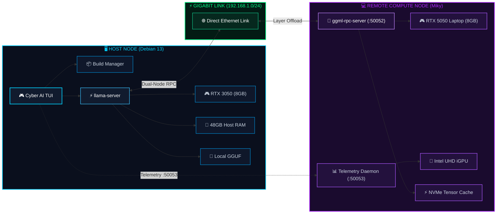
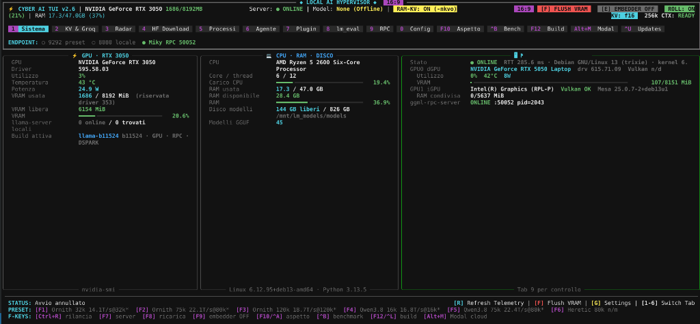
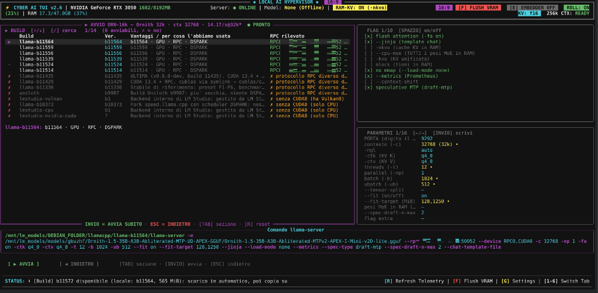
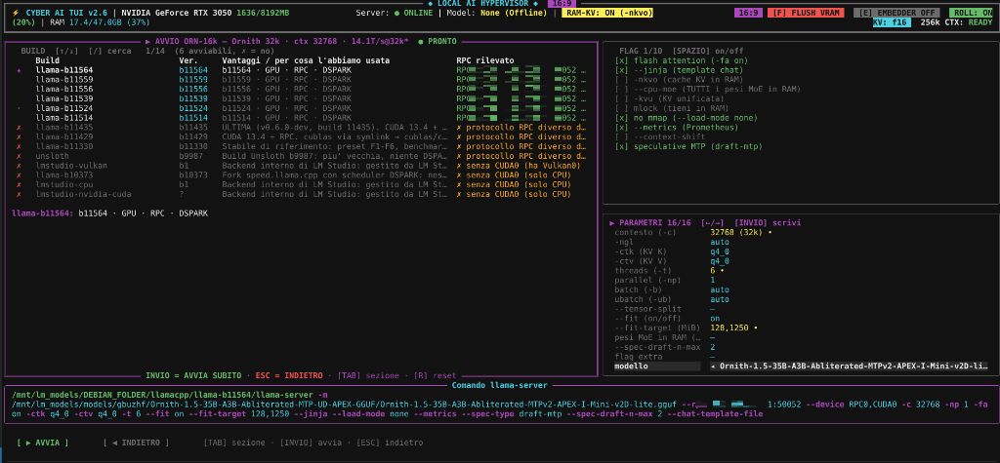
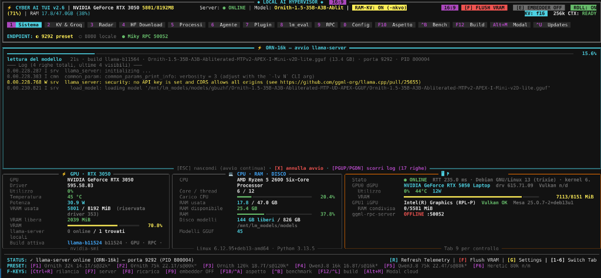

# 🚀 Cyber AI TUI — Local AI Hypervisor

[](https://www.python.org/)
[](https://github.com/Textualize/rich)
[](https://github.com/ggml-org/llama.cpp)
[](LICENSE)

**Cyber AI TUI (Local AI Hypervisor)** is an advanced, full-screen terminal user interface and process manager for local and distributed Large Language Model (LLM) inference. Built on top of Python and [Rich](https://github.com/Textualize/rich), it is specifically engineered for multi-GPU hybrid architectures, dedicated Gigabit RPC clusters, and instant preset switching.

---

## 🏛️ System Architecture

Cyber AI TUI orchestrates local compute resources alongside remote acceleration nodes via `llama.cpp`'s distributed RPC protocol (`ggml-rpc-server`).



---

## 📸 Interface Preview

### 1. 🎛️ Overview & Dual-Node Telemetry (Tab 1)
*Real-time dual-node system monitoring: Host RTX 3050 (Debian 13) alongside Remote Miky RTX 5050 (Gigabit RPC), RAM/VRAM gauges, CPU loads, and active build status.*

<p align="center">
  
</p>

### 2. ⚡ Preset & Build Launcher (F1–F6)
*Instant launch modal: select between local/remote llama.cpp builds, hardware flags (Flash Attention, RAM KV offloading, MTP speculative decoding), and target ports.*

<p align="center">
  
</p>

### 3. 🎚️ Inference Parameter Tuning & Model Catalog
*Fine-grained control over context window limits (up to 128k), KV quantization (`q4_0`, `q8_0`, `f16`), GPU layers (`-ngl`), batch sizes, and multi-threaded execution.*

<p align="center">
  
</p>

### 4. 🚀 Live Model Launch & Server Log Streaming
*Real-time weight loading, tensor layer distribution across PCIe & network RPC, and active VRAM allocation gauges during llama-server initialization.*

<p align="center">
  
</p>

---

## ✨ Key Features

### 1. 🎛️ 15 Specialized Interactive Tabs
- **Tab 1: Overview & Panoramica** — Live token throughput (tok/s), TTFT (Time To First Token), system CPU/RAM metrics, active model status, and dual-node telemetry.
- **Tab 2: Models Catalog** — GGUF inspection, quantization types, layer architecture, context limit estimates, and instant selection.
- **Tab 3: Benchmark** — Automated latency, throughput, and prompt processing evaluation benchmarks.
- **Tab 4: KV Cache Manager** — Precision tuning (`f16`, `q8_0`, `q4_0`), Flash Attention toggles (`-fa`), and VRAM budgeting.
- **Tab 7: Plugins & Extensions** — Dynamic tool and plugin manager.
- **Tab 8: LM Eval** — Model accuracy and perplexity harness.
- **Tab 9: Remote RPC Monitor** — Live tracking of the remote node (`Miky`): dGPU & iGPU VRAM usage, wattage, core temperatures, and NVMe tensor cache hit rates.
- **Tab 10: Configuration & Flags** — Interactive argument inspector and flag configuration with real-time CLI preview.
- **Tab 13: Build Manager** — Automated `llama.cpp` build management (GitHub API release tracking, atomic downloads, protected baseline builds, and symlink rotation).
- **Tab 15: Updates Monitor** — Centralized non-blocking check across host packages, driver versions, and remote cluster binaries.

### 2. ⚡ Preset Engine (F1 – F6)
Launch tuned model configurations with a single keystroke:
- **`[F1]`** — Qwen 3.8 / Mini models (low-latency, conversational)
- **`[F2]`** — Hermes / General purpose assistant
- **`[F3]`** — Ornith 16k MoE (extended context window)
- **`[F4]`** — DeepSeek / Code-specialized profiles
- **`[F5]`** — Custom High-Context Presets
- **`[F6]`** — Server control & quick restart

### 3. 🔄 Seamless Remote Synchronization
- **RPC Version Mismatch Guard**: Detects protocol deviations between local `llama-server` and remote `ggml-rpc-server`.
- **One-Click Sync (`[S]` / `[INVIO]`)**: Automatically pushes matching binaries to remote nodes via rsync/SSH and restarts remote services without restarting the TUI.

### 4. 🛡️ Fault-Tolerant Process Supervision
- **No `pkill -f` Hazard**: Tracks exact PIDs with `/proc/<pid>/exe` verification to eliminate the risk of terminating unintended shells or parent processes.
- **Graceful Signal Handling**: Manages `SIGTERM`, `SIGINT`, and non-blocking background workers safely.

---

## 📋 Requirements

- **Operating System**: Linux (Debian 12/13, Ubuntu 22.04+, Arch, etc.)
- **Python**: 3.10 or newer
- **Terminal**: Modern ANSI terminal supporting 256/true-color (Nerd Fonts recommended for glyphs)
- **Engine**: [`llama.cpp`](https://github.com/ggml-org/llama.cpp) binaries (`llama-server`, `ggml-rpc-server`)

---

## 🚀 Quick Start

### 1. Clone the Repository
```bash
git clone https://github.com/<your-username>/ai_tui.git
cd ai_tui
```

### 2. Install Dependencies
```bash
pip install -r requirements.txt
```

### 3. Configuration
Copy the sample configuration profiles:
```bash
cp config/rpc_profiles.example.json rpc_profiles.json
cp config/model_configs.example.json model_configs.json
```

### 4. Run the TUI
```bash
python3 tui_app.py
```

---

## ⚙️ Environment Variables

You can customize directories and network targets using environment variables:

| Variable | Description | Default |
| :--- | :--- | :--- |
| `AI_TUI_MODELS_DIR` | Base directory containing GGUF models | `/mnt/lm_models/models` |
| `AI_TUI_BUILD_DIR` | Base directory for `llama.cpp` builds | `/mnt/lm_models/DEBIAN_FOLDER/llamacpp` |
| `MIKY_HOST` | IP address of the remote RPC compute node | `192.168.1.100` |
| `AI_TUI_SSH_KEY` | Path to SSH private key for remote management | `~/.ssh/id_rsa_cluster` |
| `BENCHMARK_DIR` | Directory storing benchmark results | `/home/user/benchmark` |

---

## ⌨️ Keybindings Reference

| Key | Action |
| :--- | :--- |
| **`[0]` – `[9]`** | Direct navigation to Tabs 0 through 9 |
| **`[F1]` – `[F6]`** | Instant Preset Launchers |
| **`[F10]`** | Appearance & Theme Settings (Theme switcher, density, contrast) |
| **`[F12]`** | Tab 13: Build Manager |
| **`[^U]` (Ctrl+U)** | Tab 15: Updates Monitor |
| **`[^B]` (Ctrl+B)** | Tab 3: Benchmark Suite |
| **`[Alt+M]`** | Modal / Cloud integration |
| **`[S]` / `[INVIO]`** | Sync / Activate selected build to remote cluster |
| **`[K]`** | Stop / Terminate running server instance |
| **`[R]`** | Refresh telemetry and state |
| **`[Q]`** | Exit application cleanly |

---

## 📂 Project Structure

```text
Local_AI_Hypervisor/
├── tui_app.py             # 🎯 Main entry point & 15-tab Rich live rendering engine
├── backend.py             # ⚙️ Core process orchestrator & VRAM / state manager
├── servers.py             # 🛡️ Process supervisor, local llama-server & remote SSH controller
├── llama_config.py        # 🎛️ Dual-node GPU layer splitter & GGUF metadata parser
├── build_manager.py       # 📦 GitHub release tracker & local/remote build switcher
├── launch_presets.py      # ⚡ F1-F6 instant preset definitions & context rules
├── miky_remote.py         # 📡 Dual-node telemetry client (queries Miky daemon on :50053)
├── modal_ctl.py           # 💬 Interactive modal dialogs controller
├── proc_spawn.py          # 🚀 Cross-platform safe subprocess launcher
├── vram_budget.py         # 🧮 Multi-GPU tensor allocation & context budgeting formulas
├── updates.py             # 🔄 Background component-wide update monitor
├── theme.py               # 🎨 Cyber neon palette, semantic roles & ThemedConsole
├── peers.py               # 🌐 RPC peer discovery & latency monitoring
├── draft_backends.py      # ⚡ Speculative decoding backends
├── bench_results.py       # 📊 Tab 3 benchmark parser & database table formatter
├── lmbench.py             # 🧪 Local lm-eval test harness bridge
├── gguf_geom.py           # 📐 GGUF architecture & tensor geometry helper
├── atomic_json.py         # 🔒 Crash-resilient atomic JSON I/O
├── _kbd_compat.py         # ⌨️ Cross-platform non-blocking keyboard input
│
├── benchmarks/            # 📊 Comprehensive Benchmark Suites
│   ├── kv_cache/          # KV cache stress test, VRAM floor & calibration scripts
│   ├── runners/           # Automated benchmark runners & target models matrix
│   ├── bench_ornith/      # Benchmark suite for Ornith 35B MoE
│   └── bench_qwen38/      # Benchmark suite for Qwen 38B
│
├── tools/                 # 🛠️ Developer, Build & Diagnostic Tools
│   ├── miky-push-builds   # Atomic rsync push to remote cluster node
│   ├── eth_test.py        # Dedicated Ethernet link latency tester
│   ├── gen_icon.py        # TUI icon generator
│   ├── generate_presets.py# Preset JSON generator
│   ├── test_tasti.py      # Terminal keyboard input tester
│   └── legacy/            # Deprecated utilities (e.g. netscan)
│
├── miky/                  # 💻 Remote Node Windows / RPC helper scripts
│   ├── hermes_rpc_service.ps1
│   ├── rpc_tui.bat
│   └── rpc_tui.py
│
├── docs/                  # 📚 Architecture diagrams, guides & agent reports
├── config/                # 📋 Template configuration profiles
├── requirements.txt       # 📦 Python dependencies
├── LICENSE                # 📄 MIT License
└── README.md
```

---

## 📄 License

This project is licensed under the MIT License — see the [LICENSE](LICENSE) file for details.
